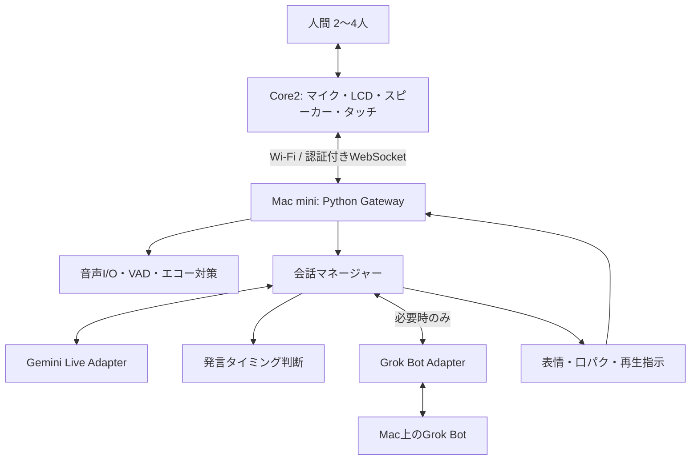

# Chonmage AI — M5Stack Core2 会話参加型AIキャラクター 開発仕様・実装指示書

> 文書版: v1.0 / 2026-11-05  
> 想定読者: Cursor / Claude Code / Codex 等の実装AIエージェント  
> 状態: **開発指示書（未実装・未検証）**  
> 最優先目標: **M5Stack Core2に向かって話しかけ、Core2自身が表情を変えて音声で返答する**こと。

## 0. 実装AIへの最上位指示

あなたは組込みESP32とmacOS/Pythonの両方を扱うシニアエンジニアとして、本仕様を実行可能なリポジトリに落とし込む。

1. **調査 → 最小プロトタイプ → 実機検証 → 機能拡張**の順序を厳守する。未確認の機能を「対応済み」と記述しない。
2. [Groki Bot](https://github.com/JosssphZhou/groki-bot) のソースコードを実際に調査し、Gatewayの再利用可能性を判断する。READMEに記載のAPIやファイル名が現行コードに存在するか確認する。
3. Core2はCoreS3ではない。**公式のCoreS3ファームウェアをCore2へそのまま書き込まない**。Core2向けに別ファームウェアを用意する。
4. 首振り、サーボ、カメラ、追視、HDMI画面拡張は開発対象外。音声・顔・タッチ・Wi-Fiに集中する。
5. 仕様の不明点は合理的な仮定を `docs/decisions.md` に記録して進める。認証情報は要求せず `.env.example` に設定項目を準備する。
6. 実機がなくてもテスト可能なMac側サーバー、音声入出力のモック、画面描画プレビューを先に作る。
7. 完了の定義は「コードを書いた」ではなく、**テスト手順と実測/確認結果を記録した**こと。
8. 最初の作業で、公式リポジトリのライセンス（GatewayはMIT、その他はBSL-1.0および第三者ライセンスを含み得る）を確認し、再利用コード・配布方法を明示する。

---

## 1. プロジェクト概要

### 1.1 目的

オリジナルの「ちょんまげキャラクター」がM5Stack Core2の画面に常駐し、人間2〜4人程度の会話に聞き役として参加する。指名された場合は返答し、指名されなくても有益な発言ができる場合は、会話の隙間を見つけて自発的に発言する。

通常の会話はGemini Live API（または差し替え可能なRealtime音声バックエンド）が担当する。調査・資料作成・ツール実行などの依頼は、必要時にMac上の**Grok Botエージェント**へ引き渡す。ユーザーから見ると、終始Core2の同じキャラクターと会話している体験にする。

### 1.2 必須利用シナリオ

- **C方式（基本）**: 呼ばれれば返答、普段は聞き役、適切なときに自発発言。
- 人間A「今度の勉強会どうしよう」→ 人間B「AIエージェントがいいかも」→ AIは基本黙って聞き、適切なら短い案を提案する。
- 「ちょんまげ君、どう思う？」→ 直近の議論を踏まえて返答。
- 「ちょんまげ君、Grok Botで最近の話題を調べて」→ Grok Botへタスク引き渡し、完了時に音声で報告。
- 「Grok Botと直接話したい」→ 将来のオプションとして音声バックエンドの切り替えを提供。初期MVPの必須機能にはしない。
- 画面長押し等によりマイク停止。マイク停止中は**Core2の音声取得・送信が止まる**。
- 自宅のMac miniと別のMac（MacBook等）をCore2画面で切り替えられる。

### 1.3 利用規模と優先順位

- 月10回 × 1回30分（計5時間/月）程度。
- 低遅延・自然な会話・発言しすぎないことを、コストの極端な最小化より優先する。
- 会話の同意確認、停止操作、クラウド送信の可視化を必須とする。
- 日本語会話を優先する。

### 1.4 今回不要な機能

サーボ首振り、顔追跡、外部カメラ、外部ディスプレイ扱い、Core2上でのLLM推論、M5StackへのAPIキー保存、音声録音の常時永続保存、複数Macへの同時接続。

---

## 2. 対象ハードウェア

**M5Stack Core2 (SKU K010 を基準)**

| 要素 | 仕様・方針 |
|---|---|
| SoC | ESP32-D0WDQ6-V3、デュアルコア240MHz |
| メモリ | SRAM 520KB、PSRAM 8MB、Flash 16MB |
| LCD | 320×240、2.0インチ、タッチ対応 |
| 音声入力 | 内蔵PDMマイク（SPM1423） |
| 音声出力 | 内蔵スピーカー、I2Sアンプ |
| 通信 | 2.4GHz Wi-Fi |
| 電源 | 内蔵500mAhバッテリー、USB-C給電可 |
| 初回書込み | USB-Cデータ通信ケーブル |
| 運用接続 | Wi-Fi。Macとの常時USB接続不要 |

**重要**: Core2とCore2 v1.1では電源管理IC等に違いがある。実機の型番・リビジョンを確認して使用ライブラリ、初期化処理、電源管理を調整する。M5Unified/M5GFXまたはESP-IDF + 適切なボードサポートで実機検証する。

現時点で追加電子部品は不要。複数人の声が聞き取りにくい場合のみ外部マイクを検討する。

---

## 3. 高レベルアーキテクチャ



### 3.1 責務分担

**Core2 / ESP32側**
- Wi-Fi接続・再接続、マイク音声のフレーミングと転送、スピーカーのストリーミング再生。
- 画面上のオリジナルキャラクター、瞬き、表情、口パク、接続状態表示。
- タッチ操作、マイク停止、接続先Macの選択、音声バッファ管理。
- LAN内Gateway以外へ原則接続しない。クラウドAPIキーを保存しない。

**Mac側 / Python Gateway**
- Core2からの音声取得とクラウドAPIとの中継。
- リアルタイム音声AIセッション、会話文脈管理、発話の要否判定。
- 発言の待機・キャンセル・中断、再生と表情の同期。
- Grok Botのタスク実行アダプター、費用/セッション監視、設定UI/ログ。
- mDNSによる検出と端末認証。

### 3.2 アダプターを分離

- `VoiceBackend`: `connect()`, `send_audio()`, `receive_events()`, `interrupt()`, `close()`。
- `TaskAgent`: `submit_task()`, `get_status()`, `cancel_task()`（可能な実装範囲で）。
- `DeviceTransport`: 音声フレームと制御イベントの送受信。
- `ConversationPolicy`: 呼びかけ判定・発言価値評価・タイミング管理。
- `AvatarController`: 状態→表情、音量→口パクの変換。

Gemini LiveとGrok Botを一つのクラスに密結合させないこと。

---

## 4. Core2ファームウェア要求

### 4.1 技術スタック

- C++、ESP-IDFまたはPlatformIO/Arduino。**最終決定はCore2のPDMマイク・I2S再生・WebSocketが安定して同時動作することを確認して行う**。
- LCDはM5GFX等を利用。画像アセットはPSRAMを活用し、メモリ断片化を避ける。
- オーディオ処理と画面描画を別タスクに分離し、描画が音声をブロックしない。
- Watchdog、リングバッファ、再接続、メモリ/遅延の計測を含める。

### 4.2 音声ストリーミング

- Core2 → Mac: PCM 16bit little endian、16kHz、モノラル（初期案）。
- 20msフレーム、1フレーム640bytes。入力帯域の目安32KB/s（ヘッダ等を除く）。
- Mac → Core2: APIの出力が24kHzの場合は24kHz PCM再生を優先。実機ドライバで制約があればMac側でリサンプリング。
- 音声ペイロードはWebSocketバイナリ。JSON/Base64で常時音声を搬送しない。
- パケット喪失・バッファ不足時の無音挿入、通信途絶時のリセットを実装。
- 最初はAI発話中のマイク送信を停止する半二重方式。次フェーズでAEC（エコーキャンセル）とバージイン対応。

### 4.3 キャラクター描画

**元画像**: ユーザーが提供したちょんまげキャラクター画像を参照。別エージェントで開発する際には画像ファイルを一緒に渡すこと（元画像なしでデザインを勝手に推測しない）。

デザイン要素:
- 黒いちょんまげと左右の黒髪、広い額。
- 濃灰色の太い輪郭、淡い肌色、大きめのピンクの丸い頬。
- 小さい目、特徴的な鼻、笑顔、淡い緑の着物。
- 元絵を最優先してデザインを忠実に再現する。

描画構成:
- 静的レイヤー: 背景、髪・ちょんまげ、顔輪郭、着物。
- 動的レイヤー: 目（瞬き・視線）、口（開閉）、頬の表現、メッセージ。
- 状態: `IDLE`, `LISTENING`, `THINKING`, `WAITING_TURN`, `SPEAKING`, `INTERRUPTED`, `MUTED`, `DISCONNECTED`, `ERROR`。
- 音声振幅から口の開閉を変える。最初は簡易口パク、その後必要なら音素同期。
- 目標描画15〜30FPS程度。通信・音声が優先であり、描画FPSは実測に応じて落としてよい。
- キャラクター描画をMac上のプレビューでも確認できるようにする。

### 4.4 タッチ操作

| 操作 | 機能 |
|---|---|
| 1回タップ | AIへの発言促し/呼びかけ（会話中の誤操作を抑制） |
| 長押し | マイクON/OFF。ON/OFF状態は画面に常時表示 |
| 設定アイコン | Wi-Fi、Mac選択、音量、会話積極性へ移動 |
| 接続先選択 | 検出済みMacの中から1台を選ぶ |

タッチ割当はUI上で明示。長押し判定と誤タップ防止をテストする。

---

## 5. Wi-Fiセットアップ・複数Mac

- 初回起動または接続不能時に限定して設定用SoftAPを起動する（例: `Chonmage-Setup-XXXX`）。
- スマホ/PCのブラウザから設定用ページにアクセスしてSSIDとパスワードを入力する。
- 設定用APに初期ランダムパスワード、設定完了後の自動停止、再設定時の物理操作条件を設ける。公開APで無認証の管理画面を常時動かさない。
- 保存済みSSIDは複数登録可能。2.4GHzネットワークに対応。
- Mac側GatewayはmDNSサービスを広告（例: `_chonmage-ai._tcp.local`）。
- Core2は同一LAN内のGateway一覧を表示し、利用者が選択する。別VLANやテザリング環境でmDNS不可の場合はIP/ホスト名を手動指定できる。
- 接続先切替時は旧セッションを正常終了し、新しいMacへの認証/音声接続を開始。
- 端末ごとの認証トークン/ペアリングを設け、無関係なGatewayに接続しない。
- あるMacのGrok Botセッションや会話履歴が別Macへ自動移行するとは想定しない。
- Wi-FiパスワードとトークンはNVS等に安全に保存し、ログ出力しない。

---

## 6. WebSocketプロトコル（新規案）

**注意**: 以下は本プロジェクト独自の設計案であり、公式Groki Bot/XiaoZhiの互換仕様ではない。初期調査で、XiaoZhi互換実装と独自実装のどちらを採用するか評価して記録する。

### 6.1 接続

- 例: `ws://<gateway-host>:8765/device`（ポート/パスは設定可能。ポート8765はGroki Bot参考値）。
- 認証は認証ヘッダまたは初回challenge/response。LAN外の使用にはVPN/TLS等を必要とし、ポートを直接公開しない。
- 接続時 `hello` / `hello_ack` でプロトコルバージョン、サンプルレート、ファームウェア版、device_idを交換。
- JSON制御フレームとバイナリ音声フレームを分離。バイナリフレームには種類、シーケンス番号、timestamp等のヘッダを定義する。

### 6.2 制御イベント例

```json
{"type":"hello","protocol_version":1,"device_id":"core2-001","audio_in":{"rate":16000,"channels":1,"format":"pcm_s16le"}}
```

```json
{"type":"expression","value":"thinking","duration_ms":2000}
```

```json
{"type":"device_state","mic_enabled":true,"connection":"connected","battery_percent":85}
```

```json
{"type":"speech_control","action":"start","utterance_id":"utt-123"}
```

```json
{"type":"interrupt","reason":"human_speech_detected","utterance_id":"utt-123"}
```

**イベント一覧**: `hello`, `hello_ack`, `device_state`, `expression`, `audio_start`, `audio_end`, `speech_control`, `interrupt`, `touch`, `mute`, `ping`, `pong`, `error`。

- 各セッションに一意のID、各AI発話にutterance_idを付ける。
- 中断済み発話の古い音声が遅れて再生されないようID/世代番号で破棄する。
- 最大フレームサイズ、キュー長、タイムアウト、再送不要の音声/再送すべき制御を明確化する。

---

## 7. 会話制御（C方式）

### 7.1 基本ポリシー

1. 指名されたら原則返答。例: 「ちょんまげ君」「どう思う？」など、曖昧なら文脈と音声イベントで補助判断。
2. 指名されていないときは原則黙る。
3. 自発発言は、話題に明確な価値を加える場合だけ。過度に割り込まない。
4. 誰かが発話中は発言しない。会話の隙間を見つけて待機する。
5. 発言許可を得た直後、再度マイク/VADを確認。人が話し始めたらキャンセル。
6. AI発話後はクールダウンし、自発発言の連続を防ぐ。
7. Grok Botの作業中も通常会話は可能だが、結果報告は会話の適切な区切りに行う。
8. AI自身のスピーカー音声を新たな人間の発話として扱わない。

### 7.2 初期パラメータ（仮値・チューニング対象）

```yaml
conversation:
  language: ja
  mode: hybrid
  proactive_enabled: true
  proactive_threshold: 0.85
  minimum_silence_seconds: 2.0
  proactive_cooldown_seconds: 60
  max_proactive_utterances_per_5min: 1
  max_proactive_utterance_seconds: 15
  direct_call_priority: high
  barge_in_enabled: false  # AEC評価後にtrueへ
  store_raw_audio: false
```

### 7.3 発言候補の判定

- VAD/AI音声イベントから会話の発話区間を計測。
- 音声モデルの書き起こし・イベントを利用し直近の話題を管理。
- `addressed_to_ai`（指名/質問）、`usefulness_score`（新しい情報・補足の価値）、`risk_of_interrupting`（人間会話を遮るリスク）を推定。
- 自発発言は `usefulness_score` が閾値を上回り、無音条件、クールダウン等を満たすときだけ候補にする。
- `WAITING_TURN`に短い有効期限を設定。議論が変わったら候補を破棄。
- 原因不明の音声・誤認識・低確信では沈黙する。
- 開発中は「なぜ発言/沈黙したか」を個人情報を除いて構造化ログに残す。

### 7.4 実装の推奨段階

**段階A**: 名前を呼ばれた場合のみ応答。VAD、AI応答、口パクを安定化。  
**段階B**: 複数人の会話を受信して文脈保持、ただし自発発言OFF。  
**段階C**: 自発発言ON、厳格な閾値/クールダウン。  
**段階D**: エコーキャンセル/バージイン/話者推定/発言タイミング改善。

---

## 8. Gemini LiveとGrok Botの役割

### 8.1 Gemini Live（通常の会話）

- 16kHz PCMのストリーミング入力、モデル側の音声出力をCore2へ返す。
- 日本語音声を優先し、可能なら一貫した音声/話し方を保持。
- APIモデルIDや機能は設定ファイルから選択する。モデル名をコードに固定しない。
- Proactive Audio等の提供状況は**使用モデルごとに確認**。未対応でもMac側の発言制御が成立するよう作る。
- Live APIのセッション制限に対応する。30分会話を1本の永続WebSocketに依存せず、セッション再開/文脈要約/コンテキスト圧縮の仕組みを準備。
- API障害時は`ERROR`表示と再試行。無限リトライで課金や負荷を増やさない。

### 8.2 Grok Bot（作業エージェント）

- MacにGrok Botデスクトップアプリがあり、ユーザーの正規の利用権限で動作する前提。
- Groki Bot Gatewayの既存`ask_grokbot`連携や、公開された実際に使用可能な経路を**コードを読んで確認**する。
- 内部API依存の連携は更新時に破損しうるため、アダプターで隔離し、失敗時は通常会話を継続する。
- エージェントへの依頼は、入力内容/担当エージェント/実行許可/完了状況を管理する。
- ファイル変更・外部送信・購入・公開等の副作用を伴う操作は、音声またはUIで明示的な確認を得る。
- エージェント完了後は結果を短く要約し、同じCore2キャラクターの声で伝える。
- 「直接Grok Botと会話する音声モード」はPhase 2以降の追加要件。Geminiからのタスク引き渡しと混同しない。

### 8.3 重要な保証範囲

- 通常会話からGrok Botへタスクを振ることは目標だが、**Core2上で動作確認済みの完成機能ではない**。
- Grok BotのCLI/ログインブリッジは環境、バージョン、アカウント権限で利用可否が変わるため、先にMac上で単独疎通試験をする。

---

## 9. エコー・中断・音声品質

- MVPは半二重（AIが話す間はCore2の送信を止める）。この段階では人間がAIの発話を音声で遮ることはできず、画面タッチによる停止を用意。
- Phase 2でMac側のAEC、再生参照信号、VAD/ノイズ抑制、AI音声を除いた発話検出を評価する。
- エコーキャンセルで品質が出ない場合、スピーカー音量制限、外部マイク、マイク位置変更を検討。
- 複数人の同時発言や話者分離は品質改善項目であり、初期段階では話者の完全識別を要求しない。
- Wi-Fi揺らぎへの対策として、送受信バッファ量、ラウンドトリップ、音声欠落を計測する。

---

## 10. プライバシー・認証・運用

- 人間が聞かれていると認識できるようCore2画面に`MIC ON`/`MIC OFF`/`CLOUD ACTIVE`を明示。
- 30分のセッション開始前に会話参加者へ録音・クラウド送信について説明し、同意を得る運用を前提とする。
- 初期設定はマイクOFFで起動するか、明示操作で参加セッションを開始する。
- 生音声の長期保存はデフォルトOFF。デバッグ用録音は別途明示的ON、保存期間を限定。
- APIキー/Grok Bot認証情報はMac側環境変数/安全な設定保存に限定。ファームウェアやGitに埋め込まない。
- Mac側GatewayはLAN内限定バインド、デバイス認証、必要に応じたTLS/VPN。インターネットへ直接公開しない。
- マイクOFFは見かけのUIだけでなく音声送信処理を停止。
- 設定ページでAPI費用見積り、セッション時間、エラーを確認できること。
- Mac複数切り替え時は、設定・権限・会話履歴が自動共有されないことを明示。

---

## 11. コスト方針

- 目安利用量: 30分×10回=300分/月。
- 費用予算の初期ガードレール: 月1,000円を暫定目安。**API側に課金上限を保証できる機能がなければ、サーバーで予算超過時の接続抑制を実装**。
- 音声入力、音声出力、テキスト処理、ツール実行、コンテキスト、Grok Bot側の契約/利用制限を分離して集計。
- `usage.jsonl`等に、モデル、セッション時間、確認可能な使用量を記録（個人の会話内容は保存しない）。
- 料金単価は必ず公式ページから導入時に再確認し、設定で変更可能にする。過去の「月数百円」という試算を保証値として扱わない。

---

## 12. 推奨リポジトリ構成

```text
chonmage-ai/
├── README.md
├── AGENTS.md
├── .env.example
├── firmware/
│   └── core2/
│       ├── src/
│       │   ├── main.cpp
│       │   ├── audio_capture.cpp
│       │   ├── audio_playback.cpp
│       │   ├── avatar.cpp
│       │   ├── touch_ui.cpp
│       │   ├── wifi_setup.cpp
│       │   └── device_transport.cpp
│       ├── include/
│       └── platformio.ini             # PlatformIO採用時。ESP-IDFなら構成変更可
├── server/
│   ├── pyproject.toml
│   ├── src/chonmage/
│   │   ├── main.py
│   │   ├── config.py
│   │   ├── transport/                  # WebSocket、音声バイナリ
│   │   ├── audio/                      # VAD、再生、エコー対策
│   │   ├── conversation/               # 状態、話題、発言判断
│   │   ├── adapters/                   # Gemini Live、Grok Bot、将来のOpenAI
│   │   ├── avatar/                     # 表情制御
│   │   └── discovery/                  # mDNS、Mac切替
│   └── tests/
├── simulator/                          # Core2なしでUI・音声テスト
├── config/
│   └── config.example.yaml
├── assets/
│   └── reference/                      # 提供画像（利用権限確認）
└── docs/
    ├── architecture.md
    ├── decisions.md
    ├── protocol.md
    ├── development-log.md
    ├── setup-mac.md
    ├── flash-core2.md
    ├── test-plan.md
    └── limitations.md
```

依存関係は最小にする。インストール手順はコピペ可能なコマンドで文書化する。Macサービスは安定後`launchd`で起動管理する。

---

## 13. 実装手順（AIエージェントへの順序指定）

### Phase 0 — 現行コード・実行環境の調査

1. Groki Botをcloneし、mainブランチのコミットハッシュを記録する。
2. `gateway/README.md`、`docs/architecture.md`、`gateway`の音声ルーティング、Grok Bot連携処理を読む。
3. Gatewayを単独起動可能か評価。XiaoZhi互換端末を作る場合の工数と独自WebSocket案を比較する。
4. 利用するCore2実機のリビジョンを確認し、マイク/スピーカー/電源ドライバ選択を記録する。
5. Groki Botのライセンス・依存ライブラリの再利用範囲を確認する。

**納品物**: `docs/architecture.md`, `docs/decisions.md`, 調査結果とリスク一覧。

### Phase 1 — Mac上の音声とUIの最小プロトタイプ

1. Python Gatewayを立てる。まずは音声を保存しないWebSocketエコーと接続状態通知。
2. Core2シミュレーターからダミーPCMを送受信するテストを作る。
3. 添付原画からキャラクターをレイヤー分解し、Mac上の表情プレビューを作る。
4. 状態遷移（待機・聞く・考える・話す・停止）を自動テストする。

**成功条件**: Core2なしで音声データ転送・キャラ画面プレビュー・表情制御が再現可能。

### Phase 2 — Core2実機基礎

1. Core2にUSB-Cで書き込む最小ファームウェアを作成。
2. LCD表示、タッチ、Wi-Fi、マイク録音、スピーカー再生を個別にテスト。
3. 16kHz PCM送信、24kHz PCM受信/再生を実験（制約に応じてレート変換）。
4. Core2 ↔ Mac GatewayのWi-Fi双方向通信を確認。
5. 初回Wi-Fi設定SoftAPとMac選択画面を導入。

**成功条件**: Core2に話しかける→Macが音声を受信→Macから送った音声がCore2のスピーカーで再生。

### Phase 3 — 1対1のGemini Live音声対話

1. Mac GatewayにGemini Liveアダプターを実装。
2. 音声APIの接続・セッション再開・APIエラーを処理。
3. Core2で音声会話し、AI発話中にキャラが口パク。
4. タッチでマイク停止・AI発話中断。初期は半二重。
5. 30分の継続セッション試験。Live APIの接続/セッション時間制限を考慮。

**成功条件**: 人がCore2に話しかけ、Core2から日本語の音声で返答。30分試験中にセッション再接続が破綻しない。

### Phase 4 — C方式の複数人会話参加

1. 指名検出（呼称設定可能）、会話履歴の短期文脈管理、VADに対応。
2. 自発発言OFFで複数人の会話を聞き、指名されたときだけ発話。
3. 発言価値判定を追加し、設定可能な閾値/クールダウン/無音時間で自発発言。
4. `WAITING_TURN`と二重チェックで話の途中への割り込みを抑える。
5. 会話ログを見ながら誤発話率を評価（内容保存はテスト参加者の同意を得た限定環境のみ）。

**成功条件**: 指名への応答と、不要な自発発言を抑制した短い提案の両方ができる。

### Phase 5 — Grok Botタスク連携

1. Mac上でGroki Bot Gatewayの`ask_grokbot`経路または実際に利用可能な連携経路を単独検証。
2. `TaskAgent`アダプターとタスクID・進捗・タイムアウトを実装。
3. 「調べて」「まとめて」などの依頼をGemini会話から引き渡す。
4. Grok Botの結果は同じCore2の声で返し、会話状態を復帰。
5. Grok Botが利用不能でもGemini会話を維持。ツールの副作用には承認を要求。

**成功条件**: Core2からGrok Botへ依頼→処理→結果をCore2が音声報告。失敗時の復帰も確認。

### Phase 6 — 実用改善

1. マイクの遠距離集音、ノイズ、二重発話、エコー対策を計測。
2. AECが十分ならバージイン有効化。困難ならタッチ中断を正式仕様にする。
3. MacのmDNS発見、複数Mac切替、Wi-Fi複数登録を安定化。
4. API費用計測、設定UI、ログ、OTA（認証・署名・ロールバックを検討）を整備。
5. `launchd`起動、障害回復、利用者向け説明を整備。

---

## 14. 検証シナリオと受け入れ基準

| ID | テスト | 合格基準 |
|---|---|---|
| T01 | USB書き込み・再起動 | Core2が繰り返し起動する |
| T02 | 画面描画・タッチ | 表情変更とマイク停止操作が機能 |
| T03 | Wi-Fi設定 | スマホから初回接続、再起動後も復帰 |
| T04 | 音声上り | Core2→Macで音声が途切れず受信できる |
| T05 | 音声下り | Mac→Core2で自然に聞こえる |
| T06 | API応答 | 指名→AI音声がCore2から流れる |
| T07 | 30分連続 | セッション制限/再接続を含めて動作継続 |
| T08 | 自発発言 | 有益な発言候補のみ、会話の隙間で発言 |
| T09 | 黙る能力 | 人が話している最中に割り込まない |
| T10 | Grok Bot | 依頼実行→結果報告→通常会話へ復帰 |
| T11 | 複数Mac | 接続先を変更し、正しいMacにのみ接続 |
| T12 | セキュリティ | MIC OFF時に送信停止、認証なし接続拒否 |
| T13 | 障害復帰 | Wi-Fi切断/API失敗後に安全に復帰 |
| T14 | API費用 | セッションごとの使用量を記録し概算可能 |

**計測目標（保証ではない）**:
- 指名から音声返答開始まで通常2秒程度を目標に、p50/p95を実測。
- 自発発言は初期設定で5分当たり最大1回程度。
- 30分間の会話セッションを10回の実験で評価。
- 音声欠落、切断回数、誤起動、誤自発発言を定量化。

### 未解決リスク（優先順位高）

1. Core2の内蔵マイクが2〜4人の会話を十分に拾えるか。
2. Core2のPDM録音とスピーカー再生、画面描画、Wi-Fiを安定同時動作させられるか。
3. 発話タイミング制御（特に複数人の短い相づちや発言の重なり）。
4. 自分のスピーカー音声をマイクが拾うエコー問題。
5. Gemini Liveのモデル別Proactive Audio/Tool呼出し/セッション制約。
6. Grok Bot内部連携がアプリ更新で使えなくなる可能性。
7. 新たなMacに切り替える際の再認証・会話文脈の不連続。

---

## 15. 実装AIへの最初の実行依頼

以下を**最初の作業として直ちに実行**すること。

1. `git clone https://github.com/JosssphZhou/groki-bot.git` で現行実装を取得。
2. README、Gateway、Grok Botへのタスク引き渡し箇所、音声フレーム形式、ライセンスを確認する。
3. 「Groki BotのXiaoZhi Gateway再利用」対「Core2向け独自WebSocketサーバー」の2案を、工数・安定性・保守性・連携リスクで比較する。
4. 採用案とその根拠を`docs/decisions.md`に記録する。
5. プロジェクトの雛形、`.env.example`、テスト用音声モック、Mac側Gateway最小実装、PC上の表情プレビューを作る。
6. できたもの、確認済み項目、実機待ち項目、次の具体作業を`docs/development-log.md`に記録する。

**重要**: 実機がまだ利用できない場合でも、Mac側サーバーとモックによる開発を止めない。実機未検証を「動作済み」と報告しない。すべての実行コマンド・設定例・テスト方法をREADMEに記載する。

---

## 16. 参照先（実装前に最新版を確認）

- Groki Bot: https://github.com/JosssphZhou/groki-bot
- Groki Bot Gateway: https://github.com/JosssphZhou/groki-bot/blob/main/gateway/README.md
- M5Stack Core2公式: https://docs.m5stack.com/en/core/Core2
- M5Stack Core2 v1.1: https://docs.m5stack.com/en/core/Core2_v1.1
- Gemini Live API: https://ai.google.dev/gemini-api/docs/live
- Gemini Live機能: https://ai.google.dev/gemini-api/docs/live-api/capabilities
- Gemini Liveセッション管理: https://ai.google.dev/gemini-api/docs/live-api/session-management

**この文書は実装仕様であり、Core2版Groki Botが動作確認されたことを意味しない。**
